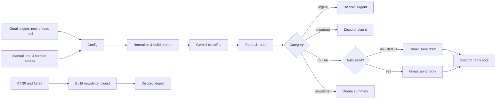

# Email Triage Agent (n8n)

An AI assistant for your Gmail inbox. Every new email is classified by Gemini into one of four lanes, and each lane is handled differently:

| Lane | Example | What happens |
| :--- | :--- | :--- |
| 🔴 **Urgent** | "Production site is down" | Discord message: handle it personally, now |
| 🟡 **Important** | "Partnership idea for Q1" | Discord message: plan or schedule a response |
| 🟢 **Routine** | "Thanks for the tips!" | AI writes a short friendly reply signed by the assistant — **saved as a Gmail draft by default** — and you get a Discord note with the reply |
| 📰 **Newsletter** | promotions, digests, notifications | Collected and summarised in one Discord digest at 07:30 and 19:30 |

## Safety by default

- `autoSend: false` — routine replies are **drafts**; nothing is sent until you flip the flag in the *Config* node.
- The prompt forbids promising dates, prices or commitments.
- If the model's answer can't be parsed, or a "routine" email has no reply text, the email goes to the **Important** lane so a human sees it.
- Senders in `ignoreSenders` are never auto-answered.

## Setup

1. Credentials in n8n: **Gmail OAuth2**, **Google Gemini (PaLM) API** ([get a key](https://aistudio.google.com/apikey)) and a **Discord Bot** that can post to your channel.
2. **Workflows → Import from file** → [`Email_Triage_Agent.json`](Email_Triage_Agent.json) and select the credentials.
3. In the four *Discord* nodes replace `YOUR_DISCORD_SERVER_ID` / `YOUR_DISCORD_CHANNEL_ID` (n8n refuses to run the workflow until these are real IDs).
4. In *Config* set `ownerName`, `assistantName` and, only if you really want it, `autoSend: true`.
5. Click **Test workflow** on *Manual Test* (four sample emails, one per lane), then activate. Gmail is polled every 5 minutes.

## Development

The JSON is generated by [`generate_workflow.py`](generate_workflow.py) (Code-node sources live there). `python test_workflow.py` runs 10 tests: structure, no secrets, drafts-by-default, and the routing / newsletter logic executed in Node.js.

## Costs and limits

- One Gemini 2.5 Flash call per email (a tiny fraction of a cent).
- The newsletter queue is kept in workflow static data, so it only builds up in production (active) runs, not in manual tests.
- Classification is AI-based; check the first days of drafts and Discord notes before trusting it fully.

## Status

Verified on 2026-10-27 on a self-hosted n8n with real Gemini calls: the four sample emails landed in the expected lanes (urgent, important, routine with a drafted reply, newsletter), with Discord and Gmail actions disabled for the test; 10 local tests passing.

## License

MIT, see [LICENSE](LICENSE). Built by [CyberResonance](https://cyberresonance.io).
